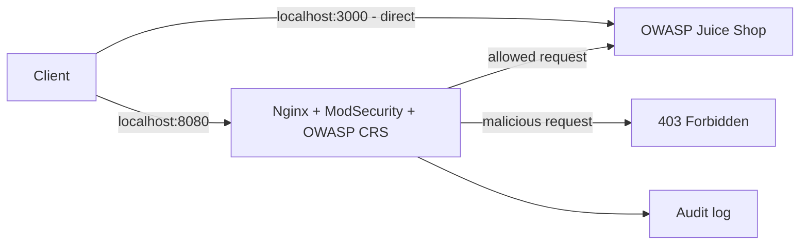
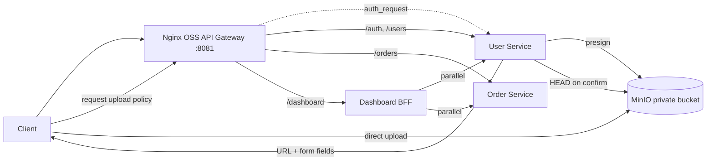

# Architecture

## Exercise 01 — WAF / Gatekeeper

Port 3000 tồn tại để chứng minh khác biệt khi bỏ qua Gatekeeper. Port 8080 là đường được bảo vệ.

## Exercise 02 — API Gateway patterns

Nginx OSS không có `auth_jwt` như một khả năng mặc định. Gateway dùng `auth_request` tới endpoint nội bộ của User Service. Dashboard BFF chỉ làm composition và error mapping, không chứa nghiệp vụ User/Order.

